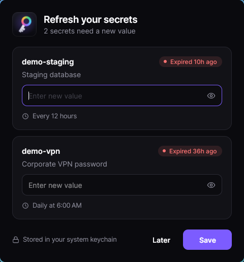
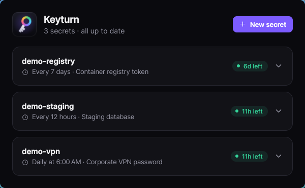

<div align="center">

# Keyturn
##### Rotating secrets in your OS credential store


</div>

Keyturn keeps rotating secrets, like a VPN password that changes every morning, in your OS credential store
instead of a `.json` file, and hands them to your other dev tools through one small CLI. A small background watcher
pops up a prompt the moment one of your secrets expires, even when no Keyturn window is open, and asks you for the
new value. The rest of the time it stays out of the way.

Every secret has its own schedule. Your tools never need to know how Keyturn stores anything: they run through
`keyturn run`, or call `keyturn get` the way they would call any credential helper. Values live only in the OS
credential store (macOS Keychain, Windows Credential Manager, Linux Secret Service). `secrets.json` in your config
dir holds names, schedules and last-set times, never values.

<p align="center">
  
  
</p>

## Table of Contents

<!-- mtoc-start -->

* [What's included](#whats-included)
* [Installation](#installation)
  * [From source](#from-source)
* [Quickstart](#quickstart)
* [Schedules](#schedules)
* [Using secrets from your tools](#using-secrets-from-your-tools)
  * [Let keyturn inject the secret](#let-keyturn-inject-the-secret)
  * [The credential-helper pattern](#the-credential-helper-pattern)
  * [The CLI contract](#the-cli-contract)
  * [What keyturn does not do](#what-keyturn-does-not-do)
* [The background watcher](#the-background-watcher)
* [Under the hood](#under-the-hood)
  * [Where secrets live](#where-secrets-live)
  * [Platform notes](#platform-notes)
* [Building from source](#building-from-source)
  * [Releasing](#releasing)
* [Acknowledgements](#acknowledgements)
* [License](#license)

<!-- mtoc-end -->

## What's included

| | |
| --- | --- |
| **`keyturn`** | The CLI and the supported way for other tools to get a secret. A self-contained single file of about 15 MB, no .NET install needed. |
| **`Keyturn.App`** | The prompt window, built with Avalonia. `--manage` opens a window to add, edit and remove secrets; `--watch` runs the [background watcher](#the-background-watcher) that opens the prompt when a secret expires. |
| **`Keyturn.Core`** | The library behind both. |

## Installation

Download the archive for your platform from the [Releases](../../releases) page and unpack it somewhere on your
`PATH`. Keep `keyturn` and `Keyturn.App` in the same folder: `keyturn` finds the app beside itself.

| Platform | Archive |
| --- | --- |
| Linux x64 / arm64 | `keyturn-VERSION-linux-x64.tar.gz`, `keyturn-VERSION-linux-arm64.tar.gz` |
| macOS Apple silicon / Intel | `keyturn-VERSION-osx-arm64.tar.gz`, `keyturn-VERSION-osx-x64.tar.gz` |
| Windows x64 | `keyturn-VERSION-win-x64.zip` |

Verify with `sha256sum -c SHA256SUMS`. After unpacking, run `keyturn watch install` once to set up the
[background watcher](#the-background-watcher) (the installers below do that for you). Each archive holds two single
files and nothing else to install:

* **`keyturn`** (CLI): a self-contained file of about 15 MB that takes about 70 ms to start, per call.
* **`Keyturn.App`**: a self-contained file of about 20 MB with its Skia and HarfBuzz native libraries embedded. On
  macOS it is `Keyturn.app`, a bundle with the Keyturn icon, signed ad hoc. On first launch .NET unpacks those
  libraries into a per-user folder (`~/.net/Keyturn.App/` on Linux and macOS, `%TEMP%\.net\Keyturn.App\` on
  Windows), which is safe to delete. Launching takes roughly 150 ms.

A few things to know:

* **The binaries are not code-signed**, and on macOS the app is only signed ad hoc, not notarized (that needs a paid
  Apple Developer ID). Gatekeeper will quarantine what you download: after unpacking, run
  `xattr -dr com.apple.quarantine .` in the folder. Windows SmartScreen will warn too.
* **macOS:** needs macOS 12 or later (the binaries declare 12 as their minimum; Microsoft's support policy for
  .NET 10 covers macOS 15 and later). `Keyturn.app` is a normal Dock app: it shows in the Dock and Cmd-Tab while a
  prompt or the manage window is open. The background watcher has no window and no Dock icon of its own. The first
  time the app reads a secret the CLI stored (or the other way round), macOS asks whether to allow keychain access;
  choose Always Allow. The ad-hoc signature changes with every build, so expect to
  be asked again after an upgrade.
* **Linux:** the app needs a graphical session and the usual desktop libraries (fontconfig, freetype). Both files
  need glibc 2.27 or newer (roughly Ubuntu 18.04 or Debian 10); each release's build summary reports the exact
  minimum. The CLI works headless apart from `--refresh`.

### From source

Prefer to build it yourself? Clone the repo and run the installer (needs the [.NET 10 SDK](https://dotnet.microsoft.com/download)).

On Linux and macOS:

```bash
git clone https://github.com/Dwarf1er/keyturn.git
cd keyturn
./install.sh
```

On Windows, from PowerShell:

```powershell
git clone https://github.com/Dwarf1er/keyturn.git
cd keyturn
.\install.ps1
```

Both build the CLI and the app and install them for the current user without administrator rights: the binaries go to
`~/.local/bin` (`%LOCALAPPDATA%\Programs\Keyturn` on Windows). Each also adds a launcher with the Keyturn icon that
opens the manage window: an application-menu entry on Linux, `Keyturn.app` in `~/Applications` on macOS (find it with
Spotlight or Launchpad), a Start Menu shortcut on Windows. On Windows the icon is also embedded in both executables.

The installers build self-contained binaries, so the .NET SDK is all they need. `./install.sh -u` (or
`.\install.ps1 -Uninstall`) removes everything they installed and never touches your secrets or config. `-c <config>`
(`-Configuration`) picks the build configuration. A build from source reports its version as `0.0.0-src`. They also
set up the background watcher and start it, so prompts appear on their own; `keyturn watch uninstall` removes just
that.

The release archives are bare binaries, so on Linux the application-menu entry comes from `install.sh`.

## Quickstart

**1. Define a secret** and when it goes stale:

```bash
keyturn add vpn daily@06:00 "Corporate VPN password"
```

**2. Give it a value.** Either run `keyturn set vpn` (hidden prompt, or pipe the value in on stdin), or let the
prompt window ask you. Keyturn waits ten minutes before prompting for a new secret that has no value yet.

**3. Make sure the watcher is running**, so a prompt appears the moment a secret expires:

```bash
keyturn watch status
```

The installers already set it up. If you unpacked a release archive instead, run `keyturn watch install` once.

**4. Use it from a tool**, without the tool knowing anything about Keyturn:

```bash
keyturn run -s vpn=VPN_PASSWORD -- ./deploy.sh
```

From here on, the prompt pops up the moment `vpn` expires and asks for a new value, and `keyturn run` refuses to
start `./deploy.sh` until you've given one. See [Schedules](#schedules) for the formats and
[Using secrets from your tools](#using-secrets-from-your-tools) for the details.

## Schedules

`12h`, `7d`, `30m` (stale that long after it was last set) or `daily@06:00` (stale once the most recent local
06:00 has passed). Stale values stay readable, but `get`/`run` refuse them unless `--allow-stale`.

## Using secrets from your tools

There are two supported ways. Neither makes your tool depend on Keyturn's code or storage format.

### Let keyturn inject the secret

```bash
keyturn run -s vpn=VPN_PASSWORD -- ./deploy.sh
```

The command runs with `VPN_PASSWORD` in its environment. The tool only knows it reads an environment
variable. `keyturn` refuses to start the command if the secret is missing or expired.

### The credential-helper pattern

Give your tool one setting, "run this command to get the password", and point it at `keyturn get`:

```bash
export DEPLOY_PASSWORD_COMMAND="keyturn get vpn"
```

```bash
PASSWORD=$(keyturn get vpn) ./deploy.sh        # in a script
```

The tool never imports or knows about Keyturn, and you can swap the command for another secret source later.
Some tools expect a *file* or an *askpass* program rather than a command setting; a two-line wrapper does it:

```bash
#!/bin/sh
# ~/bin/vpn-password: usable wherever a tool wants "a script that prints the password"
exec keyturn get vpn --refresh
```

Whether a given tool accepts such a script depends on the tool; check its docs.

### The CLI contract

| | |
| --- | --- |
| **stdout** | Only data: the secret value, or JSON with `--json`. No trailing newline when piped; one on a terminal. |
| **stderr** | All diagnostics and prompts. |
| **exit codes** | `0` ok, `1` usage error or unknown secret, `2` no value (`watch status`: not running), `3` stale, `4` storage error (credential store or config file). |
| **no surprises** | `get` never prompts on the terminal and never reads stdin. Only `--refresh` may open the GUI. |

```bash
keyturn get NAME [--refresh] [--timeout SECONDS] [--allow-stale] [--json]
keyturn run -s NAME[=ENV_VAR] ... [--refresh] [--allow-stale] -- command args...
keyturn list|status NAME|due [--json]
keyturn add NAME SCHEDULE [DESCRIPTION]     keyturn set NAME     keyturn remove NAME
keyturn watch install | uninstall | start | stop | status [--json]
```

**`--refresh`** is for unattended tools: if the secret is stale or missing, Keyturn opens the prompt for just
that secret and waits (default 5 minutes, `--timeout`), then continues with the new value. If many tools hit
the same expired secret at once, they share **one** prompt. If there's no graphical session, the prompt can't
be shown, or the wait times out, `get` exits `2`/`3` as if `--refresh` hadn't been given.

**`--json`** output is stable and never contains a secret value except in `get --json`:

```json
{ "name": "vpn", "schedule": "daily@06:00", "description": "Corporate VPN", "state": "fresh",
  "lastSetAt": "2026-10-11T06:02:11-04:00", "expiresAt": "2026-10-12T06:00:00-04:00" }
```

`state` is `fresh`, `stale` or `missing`; `list` and `due` return arrays.

### What keyturn does not do

* It doesn't authenticate callers: any process running as you can run `keyturn get`. `run` puts the secret in
  the child's environment, where other processes of the same user can read it.
* The watcher needs your desktop session: it can't prompt before you log in or on a headless machine, where tools
  get exit codes `2` and `3` instead.
* The CLI is a process per call (about 70 ms to start), and the `keyturn` binary must be on `PATH`.
* Reading the OS store directly bypasses the expiry check and is **not** a supported interface; the entry
  layout is an implementation detail and may change.

## The background watcher

Keyturn pops up as soon as one of your secrets expires, whether or not any Keyturn window is open. A small background
process, the **watcher** (`Keyturn.App --watch`), makes that happen. It has no window and no tray icon, and idles at
about 33 MB with next to no CPU. It works out which secret expires first, sleeps until that moment, and opens the
prompt. It re-reads your secrets every couple of seconds, so a new secret or a rotation made from the CLI is noticed
at once, and it checks again when the machine wakes from sleep.

```bash
keyturn watch status      # is it running, what expires next, what is snoozed
keyturn watch stop        # stop it now (it starts again at your next login)
keyturn watch start       # start it again
keyturn watch uninstall   # stop it and remove it from your login items
keyturn watch install     # set it up to start at login, and start it (the installers already do this)
```

How the prompt behaves:

* **One window, kept current.** If another secret expires while the prompt is open, it appears in the same window.
  Secrets rotated elsewhere (by a tool, or `keyturn set`) disappear from it, what you've typed is kept, and the window
  closes itself when nothing is left.
* **Later means in 10 minutes.** Closing the window without saving leaves the secret alone for ten minutes, then asks
  again. Setting a new value cancels the wait, so a freshly rotated secret that expires soon is never missed.
* **New secrets get ten minutes.** A secret you've just created and haven't given a value yet isn't prompted for until
  ten minutes after you created it, since you're almost certainly about to set it (`keyturn set`, or the Value field
  when you create it in the window). One that has gone without a value for longer prompts as normal.
* **No stacking.** There is one prompt at a time, and if a tool's `get --refresh` is already asking for a secret, the
  watcher doesn't open a second window for it.
* **On top, as far as the OS allows.** The window opens above other windows, but the OS may keep keyboard focus in
  whatever you were typing in, so you may need to click it.
* **Closing a window never stops the watcher.** Stop it with `keyturn watch stop`.
* **Failures are retried.** If the window can't open (no desktop yet at login), it tries again after 30 seconds.

`keyturn watch status` shows where the watcher's log is (`watch.log` next to your secrets file) and its last lines.
There is only ever one watcher per user; a second copy exits immediately.

It starts at login and is restarted if it dies:

| OS | How |
| --- | --- |
| Linux | A systemd user service, `keyturn-watch.service`. |
| macOS | A launch agent, `com.antoinepoulin.keyturn.watch`. |
| Windows | A Task Scheduler task, `KeyturnWatch`, that runs at logon with no time limit, on battery, and catches up after the PC was off. |

On Linux the service can start before your desktop does. It asks the systemd user manager for `DISPLAY` and
`WAYLAND_DISPLAY` each time it opens a prompt, so compositors that import those variables after login (the usual
`systemctl --user import-environment` or `dbus-update-activation-environment` line in their config) work without a
restart. If you start the compositor without systemd's user session at all, run `keyturn watch start` from its startup
commands instead.

## Under the hood

### Where secrets live

| OS | Store |
| --- | --- |
| macOS | Login keychain (generic password) |
| Windows | Credential Manager (`keyturn:NAME`) |
| Linux | Secret Service via libsecret |

### Platform notes

* **Linux** needs a Secret Service provider (GNOME Keyring, KWallet, KeePassXC, oo7), libsecret, and an
  unlocked keyring. There is no fallback for headless machines yet. The watcher and `--refresh` need a graphical
  session.
* **Windows** limits a secret to 1,280 characters.
* **macOS and Windows are newer than Linux.** CI builds, installs and smoke-tests both on real runners, but the
  credential-store code itself has only been exercised by hand on Linux so far. Expect rough edges.
* Secrets pass through managed strings and live in process memory briefly; this protects secrets at rest and
  from other users, not from malware running as you.

## Building from source

Requires the .NET 10 SDK.

```bash
git clone https://github.com/Dwarf1er/keyturn.git
cd keyturn
dotnet build
dotnet test
```

To build the release binaries for your own OS, then smoke-test them:

```bash
scripts/publish.sh linux-x64 1.0.0 dist/keyturn
scripts/smoke.sh dist/keyturn 1.0.0
```

CI builds each platform on its own runner, because the smoke tests run the binaries and the macOS bundle is signed on
macOS. The build flags live in each project's publish profiles (`src/*/Properties/PublishProfiles`), shared by
`scripts/publish.sh`, the installers and CI. `scripts/make-icons.sh` regenerates the icons in `assets/` from
`assets/keyturn-mark.svg`.

### Releasing

Pushing a tag builds and publishes everything (see `.github/workflows/release.yml`):

```bash
git tag v1.0.0 && git push origin v1.0.0      # v1.0.0-rc.1 publishes a prerelease
```

The workflow tests on Linux, Windows and macOS, builds each platform, smoke-tests it (including loading the app's
embedded native libraries), and attaches the archives and `SHA256SUMS` to a GitHub release. **Actions > release >
Run workflow** does a dry run (everything except publishing) from any branch.

## Acknowledgements

* [Git Credential Manager](https://github.com/git-ecosystem/git-credential-manager), whose macOS and Windows native
  interop declarations are adapted in `src/Keyturn.Core/ThirdParty/GitCredentialManager/` (MIT).
* [Avalonia](https://avaloniaui.net/) for the prompt window.
* [Inter](https://rsms.me/inter/) by Rasmus Andersson, converted to outlines for the wordmark (SIL Open Font License).

## License

This software is licensed under the [MIT license](LICENSE).
